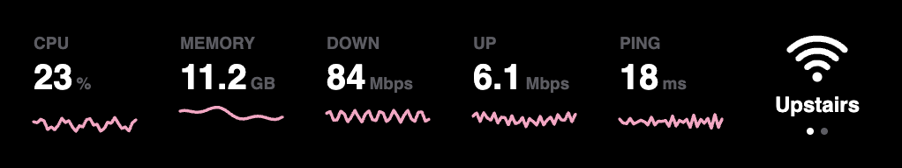

# My Mac's Vital Signs on a Stream Deck

I wanted one key that hops my Mac between my two Wi-Fi networks. Then I
wanted to see how fast the Wi-Fi was going, and then how the Mac itself
was doing, and now it's a row of keys that reads like a chart at the
end of a hospital bed. Hence the name.

Each key is a number and a pink line of the last minute. I also can
never remember which of these is which, so every key explains itself:
click it in the Stream Deck app and it says what it measures, whether
the number is fine, and what to do if it isn't.



| Key | What it shows |
|---|---|
| 🧠 CPU | How busy the processor is, 0 to 100% |
| 🗂 Memory | Memory in use, the same number as Activity Monitor's "Memory Used" |
| 🫧 Memory Pressure | Whether the Mac is short of memory: 100 minus the percent the Mac says is available. The line turns yellow at warning and red at critical |
| ⬇️ Download | What's coming in right now, in Mbps |
| ⬆️ Upload | What's going out right now |
| 🏓 Ping | How long the internet takes to answer, in ms. A dash means no answer |
| 📶 Switch Network | Which of my networks the Mac is on. A press joins the next one |

These pictures are drawn by the plugin's own drawing code, not
photographed off the deck. The network names in them are made up.

A press on any of the six stat keys opens the whole Mac Vitals page.
So one of them can live on another page and be the door to the rest.
Each key's settings have an "Open on" menu for which deck the page
opens on: Memory sits on my XL's Home page and brings the page up on my
Stream Deck +.

## The Wi-Fi key


On a network, on its way to the next one, arrived, missing a password,
on a network that isn't in my list, and Wi-Fi off. The dots are my
list, and the lit one is where the Mac is.

It needs two things from me.

**The list.** In the key's settings there's a Networks box: one network
per line, spelled exactly like in the Wi-Fi menu. A long name can get a
short one for the key:

```
My Very Long Network Name = Home
Office 5G
```

**The passwords.** Once per network, in Terminal. It asks for the Wi-Fi
password twice and shows nothing while I type:

```bash
security add-generic-password -U -s wifi-toggle -a "Office 5G" -w
```

That saves a copy in my login keychain under `wifi-toggle` (the
plugin's first name, from when it was only this key). To take one out
again:

```bash
security delete-generic-password -s wifi-toggle -a "Office 5G"
```

## Setting it up

It needs a Mac, Stream Deck 7.1 or newer, Node 24 and Elgato's
`streamdeck` command (`npm install -g @elgato/cli`).

```bash
npm install
streamdeck link com.malikacodes.mac-vitals.sdPlugin
```

The keys are then in the action list under Mac Vitals. There are two
ready-made layouts as well, one for the XL and one for the Stream Deck
+. Linking doesn't install them, so I open the one I want:

```bash
open com.malikacodes.mac-vitals.sdPlugin/profiles/mac-vitals-xl.streamDeckProfile
```

```bash
open com.malikacodes.mac-vitals.sdPlugin/profiles/mac-vitals-plus.streamDeckProfile
```

The Home key in those layouts points at my own Home profiles, so on
another Mac it goes nowhere until it's pointed somewhere else.

`npm test` runs the tests, and `npm run profiles` rebuilds the two
layout files from `scripts/profiles.mjs`.

## How it works

```
every 2 seconds → vitals.js (ask the Mac) → draw.js → the five stat keys
                        ↓
                   explain.js → the settings page of whichever key I clicked

key press → wifi.js (which network now? join the next) → draw.js → the Wi-Fi key
```

- `vitals.js` reads everything with tools the Mac already has:
  `vm_stat` for memory, `netstat` for the byte counts, `ping` for ping,
  and Node's own core timings for the CPU. No extra permissions.
- `wifi.js` finds out which network the Mac is on, and joins another
  with `networksetup`.
- `explain.js` turns the last minute of readings into words: a verdict
  and what it means for me.
- `draw.js` makes the pictures as SVG text.
- `index.js` is the only file that talks to Stream Deck.

## Choices I made

- **The network name comes from a side door.** macOS hides the name of
  the current network from every command unless an app has Location
  permission. But it leaves a note about the connection where `scutil`
  can read it, and the name is inside. So the key shows the real
  network and keeps up when I switch from the menu bar. No permission
  prompt, and no guessing from a saved "last one I joined".
- **Passwords live in my keychain, not in Stream Deck.** The Mac won't
  join a network from the command line without being handed the
  password, even one it's already on. Stream Deck's settings are plain
  text in a file, so the passwords go in the keychain and are typed at
  a hidden prompt.
- **My network names aren't in the code.** A network name can be looked
  up on a map, so mine stay out of anything that gets committed. They're
  typed into the key's settings, and the ready-made layouts ship with
  the box empty.
- **One switch at a time.** Presses during a switch are ignored. A
  switch takes 5 to 8 seconds, and that part is the Mac.
- **Speeds are never good or bad.** Down and Up show what's moving, not
  what the connection could do. Zero is normal when nothing is loading,
  so those two only describe. Ping is the one that says whether the
  internet is struggling.
- **CPU is judged on the whole minute.** Opening an app sends it to
  100% for a second. That isn't a problem and shouldn't read like one.
- **Pressure is the Mac's own call.** Memory in use can sit at 80% on a
  Mac that's perfectly fine, because macOS fills spare memory on purpose
  and gives it back when an app asks. The Pressure key's color and
  verdict come straight from the kernel's level, the one behind Activity
  Monitor's colored graph, not from a cut-off of mine. Its number is
  `100 - available` so that up means worse on every key, which also
  means it isn't a number Apple shows anywhere. The details are in
  `docs/memory-pressure-key-prd.md`.
- **The cut-offs are rules of thumb.** 85% CPU, 90% memory, 250 ms
  ping: they're where things usually start to feel different, not
  numbers from a manual. Memory is judged as a share of the Mac's
  total.

## Known limits

- The side door isn't a documented one. An update to macOS could close
  it, and then the Wi-Fi key would say "Other Wi-Fi" on every network.
- After a press, the menu bar's Wi-Fi list can be a few seconds behind.
  The key is the one to trust. I checked this against the channel the
  Mac was really on.
- `networksetup` takes the password as part of its command, so for the
  moment it runs, another program on my Mac could see it.
- Ping goes to one server, Cloudflare's `1.1.1.1`. If that server is
  having a day, the key will blame my internet.
- Speeds count Wi-Fi and Ethernet together.
- I haven't tried it on any Mac but mine.

## What's next

- Dials on the Stream Deck +. The plugin has no dial actions yet, so
  the + layout leaves them empty.
- Battery and disk space keys.
- More rows for the XL. Six keys on a 32 key deck is a lot of quiet.

The story of how it got here is in [journal/](journal/).
