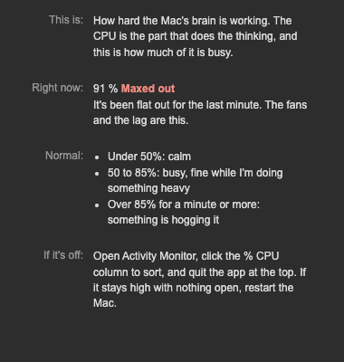

# 02 · Keys that explain themselves

2026-10-13

Two things today: ready-made layouts for both of my decks, and a
settings page on every key that says what the key is for. The second
one is for me. I had a row of numbers and no idea which ones were bad.

## The layouts

There's one for the XL and one for the Stream Deck +. The computer's
readings sit on the left and the network's on the right, with a Home
key where my other profiles keep theirs: top left on the XL, top right
on the +.

They're built by `scripts/profiles.mjs`, never by hand. I borrowed the
shape from another plugin of mine, which got it from a real export.

**They didn't install.** I listed both in the manifest with
`AutoInstall`, linked the plugin again, and nothing showed up. Stream
Deck only installs a plugin's layouts on a fresh install, and linking a
folder I'm working in counts as a reload. What did work was opening the
file:

```bash
open com.malikacodes.mac-vitals.sdPlugin/profiles/mac-vitals-xl.streamDeckProfile   # Stream Deck imports it
```

**The Home key looked like a typo.** I'd put the word "Home" on it, and
it landed right on top of Stream Deck's stock icon for switching
profiles. Two things in one spot, neither readable. It has its own
picture now, a plain house on black, and no word.

The Wi-Fi key arrives in both layouts saying "Add networks". That's on
purpose. My network names don't go in a file that gets committed, and
there's a test that fails if they ever do.

## The settings pages

> What's the difference between CPU and memory, again?

I have a computer science degree in progress and I still mix these up
when I'm looking at a number and something feels slow. So each stat
key's settings page has four rows:

| Row | What it says |
|---|---|
| This is | What the key measures, in plain words |
| Right now | The number, one word for how that is, and what it means |
| Normal | The numbers to compare against |
| If it's off | What to actually do |



That picture is the page drawn in a browser with a pretend reading, to
show the red. On a normal day it says "Calm" in green.

How I think of them now:

- **CPU** is how hard the brain is working. Red means quit whatever is
  on top in Activity Monitor.
- **Memory** is how full the desk is. Red means close things.
- **Down and Up** are the speedometer, not the top speed.
- **Ping** is how long the internet takes to answer. Red means try the
  other network, and if that's bad too, go turn the router off and on.

"Right now" is live. The page asks the plugin for its words when it
opens, and the plugin sends them again after every reading.

## Where the lines are

The cut-offs are rules of thumb: where a Mac or a connection usually
starts to feel different. Three of them took some thought.

- **CPU is judged on the last minute, not the last reading.** Opening
  an app spikes it to 100% for a second. If the page turned red every
  time I opened Notion I'd stop believing it by lunch.
- **Speeds are never good or bad.** A quiet connection is what a Mac
  looks like when nobody is downloading anything. If zero counted as
  bad, every calm evening would look like broken internet.
- **One missed ping is nothing. Three of the last five is the internet
  being down.** Any Wi-Fi drops a packet now and then.

Memory is judged as a share of what the Mac has, so 12 GB reads as
"getting full" on my 16 GB and would be roomy on a bigger one.

## Did it work?

- `npm test`: 40 pass. The verdicts have their own, like "one spike in
  a calm minute is still calm".
- `streamdeck validate`: passes, with both layouts listed.
- Both layouts imported, and the XL one showed real readings in the
  Stream Deck app.
- Still to do with my own eyes: watch "Right now" tick over in the real
  app. I've only seen the page in a browser so far.

## What I learned

- A linked plugin never gets its bundled layouts. Open the files.
- A number without "is that good?" is decoration.
- Deciding what counts as bad is harder than reading the number.

## What's next

- Dials. The + layout has four empty ones.
- Battery and disk space, so the XL page is less lonely.
