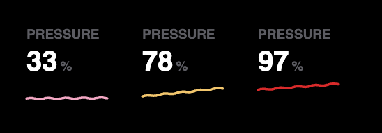

# 10 · Memory pressure

2026-10-22

I was cleaning up my Mac one day. Only 11 GB of memory in use, which on
a 16 GB Mac didn't sound like much. Activity Monitor's memory pressure
graph was red anyway.

That made no sense to me, so I went digging. Memory used and memory
pressure are two different things. Used is how much the Mac is holding.
Pressure is whether it's struggling to make room for what comes next.
A Mac fills spare memory on purpose and hands it back when an app asks,
so the number in use can look fine while the Mac is squeezed, or look
full while it's completely relaxed.

So you know I had to build a key for it.

## It goes the other way too

When I sat down to build it, I checked what the Mac itself says:

```
$ sysctl -n kern.memorystatus_vm_pressure_level kern.memorystatus_level
1
67
```

Level 1 is normal, with 67% of memory available. At that same moment my
Memory key read 12.7 GB of 16, 79%, and called it "Getting full". The
opposite of the day the graph went red, and the same lesson: "how full"
was never the right question. "Is the Mac short of memory" is, and
that's what Activity Monitor's green, yellow and red graph answers.

## Planning it properly

This one got a written plan first, in `docs/memory-pressure-key-prd.md`,
because there were real choices in it. I looked at it twice more after
writing it, and both times it changed:

- **Which way the number goes.** I'd first picked "67 % free", the
  kernel's own number. On a key labelled PRESSURE, that line would fall
  as pressure rose. Every other key on the page goes up when things get
  worse. So the key shows `100 - available`: 33 today.
- **Two numbers, one pipe.** The kernel gives a level and a percent.
  Every stat key keeps one number per reading. The percent goes in the
  history like everything else, and the level rides alongside, used
  only for the color and the verdict.
- **What a failed reading looks like.** If the Mac was at warning and
  one reading fails, falling back to pink would say "normal" for a look
  that didn't work. The line keeps its last color, and the number shows
  a dash.

I also took the narrow option seriously: fix the Memory key and add
nothing. But I want to see the pressure number itself, so it's a key.

## The key

Pink at normal, like the five beside it, so on an ordinary day it's
just one more key. Yellow at warning, red at critical.

The first red was the settings page's soft salmon. Drawn next to a pink
key on black it barely looked different, which is a problem for the one
level I must not miss. It's a deeper red now, `#d92b2b`. The verdict on
its settings page is the kernel's level, not a cut-off of mine.



> Heads up: macOS has a `memory_pressure` command that shows the same
> number, but it's a stress-test tool. With the wrong option it eats
> memory or makes the whole Mac act like it's out of room. The key
> reads the number with `sysctl` instead, which can only look.

## Did it work?

- `npm test`: 100 pass. The new ones cover the parsing, the colors, the
  verdict, and the warning color surviving a failed reading.
- `streamdeck validate` passes, and the pretend deck draws all six stat
  keys.
- On the real deck, the plugin restarted cleanly. The Pressure key
  itself still needs dragging on or the layouts reinstalling, so I
  haven't seen it on the deck yet.
- I've only ever seen level 1. Warning and critical are tested, not
  watched.

## What I learned

- Check what the Mac thinks before trusting my own cut-offs.
- A number that goes down when things get worse is a trap on a row of
  numbers that go up.

## What's next

- The Memory key's verdict should follow the pressure level too. Right
  now the two keys can disagree on screen.
